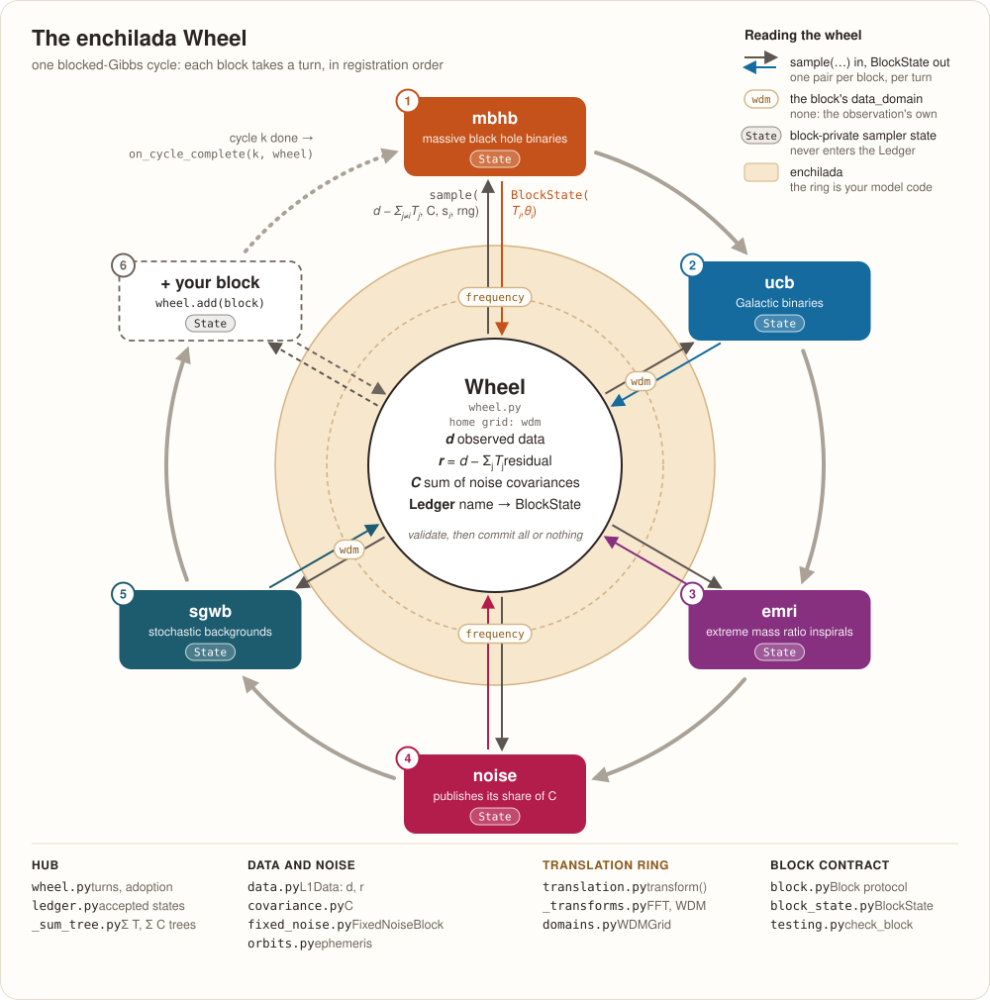

# enchilada

[](https://github.com/AaronDJohnson/enchilada/actions/workflows/ci.yml)
[](LICENSE)

Blocked-Gibbs global-fit orchestration for LISA.

*The whole enchilada*: a global fit infers every source population and the
instrument noise **together**, because none of them can be measured cleanly
without the others. This is the layer that makes that one joint fit out of
many separately-owned pieces.

A `Wheel` owns pristine L1 observations, a working residual, the sum of the
noise blocks' covariances, and a `Ledger` containing each block's accepted
`BlockState`: an optional signal template, an optional covariance, and physical
parameters. The campaign lives on one WDM grid chosen at construction, its
*home grid*; every block is served on the grid it asks for. Every block declares
its role, `"signal"` or `"noise"`, as an attribute. Given an output path, the
Wheel also records every block's parameters, step by step, to a campaign file.
Each block owns its sampler continuation state and diagnostics. The Wheel supplies
the data minus all other blocks' signals, the covariance the block's role
receives, and the block's accepted physical state, then validates and adopts
the returned estimate.
Waveforms, likelihoods, and prior/conditional sampling remain model code.



*Blocks take turns clockwise, in registration order. enchilada owns the hub, the
spokes, and the translation ring; everything on the ring is model code.*

## Install

Requires Python ≥ 3.12 (floor set by domania and lisaorbits).

```sh
pip install enchilada      # or: uv add enchilada
```

To work on enchilada itself, clone it and use [uv](https://docs.astral.sh/uv/):

```sh
git clone https://github.com/AaronDJohnson/enchilada.git
cd enchilada
uv sync
```

or with pip: `pip install -e .`

The core depends on NumPy (`>=2.1`), SciPy (`>=1.14.1`), h5py (`>=3.12.1`, for
the campaign file) and [domania](https://pypi.org/project/domania/)
(`>=3.0,<4`), which performs the WDM transforms. GBGPU, Eryn, and LISA Analysis
Tools are confined to the optional galactic-binary example. Installing enchilada or
any of its extras does not install them; running that example requires the
separate `examples/requirements-gb.txt` installation described below.

SciPy and h5py are core, so `NumericOrbit` (interpolation and `from_hdf5`),
Mojito L1 loading (`enchilada.mojito`) and decimation (`enchilada.resample`)
need no extra; only `NumericOrbit.from_lisaorbits` needs the `numeric-orbits`
extra:

```sh
uv sync --extra numeric-orbits   # adds lisaorbits

# For the notebooks (matplotlib arrives with lisaorbits), install both extras:
uv sync --extra numeric-orbits --extra examples
uv run --no-sync jupyter lab examples/demo.ipynb
```

## Quickstart

```sh
uv run --no-sync python examples/demo.py
```

runs three Gibbs cycles over two zero-signal `EchoBlock`s on synthetic data —
enough to watch the Wheel hand each block its residual. The whole thing is:

<!-- runnable -->
```python
import numpy as np
from enchilada import L1Data, Wheel
from enchilada.testing import EchoBlock

rng = np.random.default_rng(0)
num_time_samples = 1024
channel_names = ("A", "E", "T")

# One frozen object holds the TDI arrays and the run settings everyone shares.
observed = L1Data(
    {ch: rng.standard_normal(num_time_samples) for ch in channel_names},
    sample_rate_hz=0.1,
    tdi_generation="2.0",
    physical_observable="fractional_frequency",
)  # num_time_samples is read off the arrays; start_time_gps defaults to 0.0

ucb = EchoBlock(name="ucb")
mbhb = EchoBlock(name="mbhb")

# The campaign lives on a WDM home grid: 32 rows x 32 columns for 1024 samples.
# EchoBlock declares role = "signal"; Wheel reads the attribute at add.
wheel = Wheel(observed_data=observed, num_frequency_divisions=32)
wheel.add(block_to_register=ucb)
wheel.add(block_to_register=mbhb)
wheel.run(num_cycles=3)

wheel.residual()  # the running residual: observed minus every block's template
# The diagnostic counter belongs to the block.
assert ucb.state.num_sample_calls == 3
```

[`examples/demo.ipynb`](https://github.com/AaronDJohnson/enchilada/blob/main/examples/demo.ipynb) is the same walkthrough with
commentary, plus the `L1Data` long/short name aliases (`Tobs`, `fs`, `dt`,
...), the typo catcher, and attaching a constellation ephemeris. For a real
(toy) sampler — two conjugate-Gibbs source blocks plus a sampled
white-noise block, converging to known truth — run
[`examples/toy_fit.py`](https://github.com/AaronDJohnson/enchilada/blob/main/examples/toy_fit.py);
its noise block models the whole noise, so it must be the campaign's only
noise block. For two noise blocks whose covariances Wheel adds — a known floor
from a `FixedNoiseBlock` plus a sampled excess — run
[`examples/noise_floor.py`](https://github.com/AaronDJohnson/enchilada/blob/main/examples/noise_floor.py);
its excess block assumes time-domain data with independent channels and needs
the floor registered before it.

To write your own block, work through the
[Block authoring tutorial](examples/create_block.ipynb). It builds a Metropolis
sampler from scratch, starts its main campaign at a known injection, checks its
posterior, demonstrates continuation and domain selection, and adds a noise
block using the same interface; that block models the whole noise, so it must
be the campaign's only noise block.

For a **real LISA source class**, [`examples/gb_block_eryn.ipynb`](https://github.com/AaronDJohnson/enchilada/blob/main/examples/gb_block_eryn.ipynb)
fits an injected galactic binary through the Wheel using GBGPU waveforms, an
Eryn sampler with block-owned continuation state, and a fixed LISA noise PSD from LISA
Analysis Tools. Everything that is *not* enchilada lives in
[`examples/gb_model.py`](https://github.com/AaronDJohnson/enchilada/blob/main/examples/gb_model.py), so the notebook shows only the
enchilada touchpoints. That example needs an external LISA stack — none of it
an enchilada dependency, so it is not exercised by CI:

```sh
uv sync --extra numeric-orbits --extra examples
uv pip install -r examples/requirements-gb.txt
uv run --no-sync jupyter lab examples/gb_block_eryn.ipynb
```

Run these commands from the checkout root, in this order. Sync the project extras
first, then install the external stack: a later exact `uv sync` removes packages
that are outside the project lockfile. `--no-sync` launches Jupyter in that prepared
environment. The example requirements constrain NumPy to `<2.4`: released Eryn
1.2.6 calls `numpy.in1d`, which was [removed in NumPy 2.4](https://numpy.org/devdocs/release/2.4.0-notes.html#removed-numpy-in1d).
This constraint applies only to the optional example environment.

Every piece of it ships wheels, so nothing compiles. But `gbgpu` and
`lisaanalysistools` publish *no* sdist, which fixes the example's window
narrower than enchilada's own: **Python 3.12–3.13, on Linux or Apple-silicon
macOS**. Intel macOS, Windows, and 3.14 have no wheels, and pip reports that as
`No matching distribution found` rather than a build error — see the header of
[`examples/requirements-gb.txt`](https://github.com/AaronDJohnson/enchilada/blob/main/examples/requirements-gb.txt)
for the full matrix. Wheel availability and dependency resolution do not establish
native GBGPU runtime validation. Its outputs are not committed; run it to populate them.

## Plugging in your sampler

Implement the `Block` protocol:

- `name`: unique within a Wheel.
- `role`: `"signal"` or `"noise"`, declared on the block (a class attribute
  such as `role = "signal"`); `Wheel.add` reads it once.
- `initial_sample(conditional_residual, covariance, *, rng) -> BlockState`:
  draw or construct the block's start from the data minus the starts of the
  blocks registered before it; `Wheel.add` calls it once at registration.
- `sample(conditional_residual, covariance, current_block_state, *, rng) -> BlockState`:
  sample against the data minus every other block's latest signal and return
  the new physical estimate.
- `state_from_parameters(parameters, reference_data) -> BlockState`: rebuild
  the state these parameters describe on `reference_data`'s grid (the block's
  registered grid). Use only the parameters, the block's constructor
  configuration and `reference_data`'s grid metadata and orbit, never its
  channel values, a random stream or anything `sample` changes. Values read
  back from a campaign file arrive as numpy types (`np.float64`, `np.int64`,
  `np.bool_`, and a list as an ndarray), so avoid `isinstance(x, int)` and list
  operations. The simplest block ends `initial_sample` and `sample` by calling
  it. `check_block` and `L2Data` call it; the Wheel never does during sampling.

`conditional_residual` is an `L1Data`; `covariance` is a `Covariance` on the same
grid as `conditional_residual`, or `None`: a signal block receives the sum over
every noise block, a noise block the sum over the *other* noise blocks (its own
last publication is on `current_block_state.covariance`); and
`current_block_state` is that block's previous accepted `BlockState`.
Use the supplied NumPy RNG for draws. Wheel commits its progress only with a valid
returned state. Keep walkers, adaptation, counters, diagnostics, and external sampler
RNG state on the block instance, for example in a nested dataclass with typed fields:

```python
from dataclasses import dataclass

class MyBlock:
    role = "signal"  # publishes a template; Wheel reads this at add

    @dataclass
    class State:
        num_sample_calls: int = 0
        log_likelihood: float | None = None

    def __init__(self, name: str):
        self.name = name
        self.state = self.State()

    # Implement initial_sample(...), sample(...) and state_from_parameters(...);
    # self.state carries sampler continuation; state_from_parameters must not
    # read self.state.
```

`State` is defined by each block; it is not an enchilada interface. Use separate
block instances for independent campaigns. Wheel neither copies nor rolls back
this block-local state.

A `BlockState` publishes exactly three fields:

| Field | Contents |
| --- | --- |
| `template` | Optional dictionary of channel arrays containing the **sum** of this block's modeled signals. `None` means zero signal; a noise block leaves it `None`. |
| `covariance` | A noise block's complete covariance, which Wheel adds into the campaign covariance; a signal block leaves it `None`. |
| `parameters` | Physical model values, such as amplitudes, source counts, or noise levels; defaults to an empty dictionary. |

Each return replaces the block's previous published snapshot. A missing template
removes any signal that block previously published. A zero-source or diagnostic
signal block can return `BlockState()`;
`conditional_residual.zero_block_state(parameters=...)` constructs explicit zero
arrays when they are useful.

For example, after calculating a new amplitude:

```python
self.state.num_sample_calls += 1
self.state.log_likelihood = log_likelihood
new_block_state = conditional_residual.block_state(
    template={"A": amplitude * basis},
    parameters={"amplitude": amplitude},
)
```

One `sample()` call is one block's turn in a Wheel cycle. It may perform many
internal sampler steps. EchoBlock's `state.num_sample_calls` counts calls to
`sample()`, not individual sampler draws; its `state.metadata` holds diagnostics.

Published parameters must support deep copying and, when the Wheel records a
campaign file, be recordable (see [Campaign output](#campaign-output)). Keep
open files, processes, GPU resources, and sampler history on the block or in an
external sink, outside `BlockState`. A returned `L1Data` is rejected: blocks
return a `BlockState`.

Every block draws or constructs its own start. `Wheel.add` calls the block's
`initial_sample` once with the observations minus the adopted starts of the
blocks registered before it, on the block's grid, together with the covariance
its role receives (`None` while the noise sum is empty) and the campaign RNG,
then validates and adopts the returned state exactly like a `sample` return.
For a known injection, make the start block configuration:

```python
signal_block = SineAmplitudeBlock(
    name="signal", frequency_hz=0.004, start_amplitude=injected_amplitude
)
wheel.add(block_to_register=signal_block, data_domain="time")
```

A block whose start is not configured draws it from its prior with the `rng`
it is handed, so a seeded campaign reproduces its starts as well as its
chains; registration consumes the campaign RNG only when `initial_sample`
draws from it. The Block protocol requires `name`, `role`, `initial_sample`,
`sample` and `state_from_parameters`. The
[Block authoring tutorial](examples/create_block.ipynb) shows a complete
example. Return signal arrays on the block's requested domain and WDM grid, or
the observations' own grid if no domain is selected; Wheel transforms them onto
its home grid for storage. A noise block's start carries its covariance on the
block's own grid, like a template; the ledger keeps it there and the noise sum
receives its translation (see
[Time, frequency, and WDM translation](#time-frequency-and-wdm-translation)).
Blocks start in registration order: register the noise blocks before the
blocks whose starts need their covariance.

Wheel validates and defensively copies the published state before adopting it
atomically.
The model must check that its parameters, rendered signal, and algorithm state
agree and that the parameters lie within its prior support; Wheel cannot establish
these scientific conditions.
The adopted start changes the ledger and residual, while preserving the
observations and declared prior. Subsequent calls sample normally; starting
at an injection does not hold its parameters fixed. Registration starts one
block; restoring a whole campaign checkpoint, including the Wheel RNG state,
is outside `add` (see [Known limitations](#known-limitations)).

`L1Data` holds channel arrays and observation conventions. A known noise model
is a noise block too: `FixedNoiseBlock` publishes an explicit `Covariance` on
every call, so register it before the blocks that need it:

```python
import numpy as np
from enchilada import Covariance, FixedNoiseBlock, Wheel

noise = Covariance.like(
    observed, {ch: np.full(observed.N, 0.25) for ch in observed.channel_names}
)
wheel = Wheel(observed_data=observed, num_frequency_divisions=32, random_seed=42)
wheel.add(FixedNoiseBlock("instrument", noise))
```

A campaign has no covariance until a noise block publishes one at
registration; `wheel.covariance` is `None` before that and the sum over every
noise block after. `Covariance.like(data, pairs)` is the one classmethod: it
takes the `L1Data` whose grid and channel order the covariance adopts and a
mapping from channel names (`"A"`), concatenated pairs (`"AE"`) or
`(first, second)` tuples to arrays of the data's channel shape. Every channel's
own entry is required; an absent cross term is zero; two keys naming one pair
raise `ValueError`.

A covariance holds variances in the squared units of the data's coordinates on
its grid: `x_n**2` in time, `(dt * rfft(x))**2` in frequency, squared WDM
coefficients in WDM. The package converts neither to nor from a one-sided PSD;
that is a noise block's business. The one convention a block needs follows from
`X = dt * rfft(x)`: stationary noise with one-sided PSD `S` has bin variance
`C_k = (Tobs / 2) S(f_k)` at every rfft bin, `f = 0` and Nyquist included, with
`Tobs = N / fs`. White noise of variance `sigma**2` per sample therefore has
`C_k = N * dt**2 * sigma**2` at every bin and `dt * sigma**2` at every WDM
cell. A block that
evaluates a PSD model at `f = np.fft.rfftfreq(spectrum.N, spectrum.dt)` builds
its covariance with
`Covariance.like(spectrum, {ch: spectrum.Tobs / 2 * model.psd(f) for ch in spectrum.channel_names})`
and reads a channel's bin variances back with `noise.pair("A", "A")`.

Signal blocks and noise blocks implement the same `Block` protocol; the block's
`role` attribute says which one it is. A noise block publishes its
covariance directly, with no signal arrays:

```python
from enchilada import BlockState

new_block_state = BlockState(
    covariance=covariance,
    parameters={"sigma": sigma},
)
```

Wheel adds the noise blocks' covariances: with an `instrument` block and a
`confusion` block registered as noise, every signal block receives
`instrument + confusion`, and each noise block receives the other's covariance
(`None` when it is the only noise block), so a component model adds its own
covariance to what it is handed for its likelihood. A noise block must return
its complete covariance on every call, even when unchanged, and may not return
a template; a signal block may not return a covariance. Either violation is
refused with `ValueError` naming the block, the method and the role, and
leaves the campaign unchanged; a template is checked for its grid and
finiteness before the role, so an off-grid template from a noise block reports
the grid. A model with a signal part and a noise part is two blocks.
`state.with_covariance(covariance)` builds a new state with that covariance,
and `noise_a + noise_b` adds two covariances on one grid (the sum is validated
like any construction). [`examples/noise_floor.py`](examples/noise_floor.py)
runs a known floor and a sampled excess as two noise blocks; the excess block
adds its variance to the floor it is handed, so it refuses to start without one
and registers after the floor, and its likelihood assumes time-domain data with
independent channels. The white-noise blocks of `examples/toy_fit.py` and the
[Block authoring tutorial](examples/create_block.ipynb) model the whole noise
and refuse to run beside another noise block.

A `Covariance` is read through its channels. `noise.A`, `noise.E`, `noise.T`
are each channel's own variances; `noise.AE`, `noise.ET`, `noise.AT` are the
cross terms (or `noise.pair("A", "E")` for names that do not concatenate
cleanly), with `noise.EA` the complex conjugate of `noise.AE`; an absent
cross term reads as zero. When the channels are exactly X, Y, Z the names
A, E, T and their pairs are derived on demand with the orthonormal LDC
combination A = (Z − X)/√2, E = (X − 2Y + Z)/√6, T = (X + Y + Z)/√3, and
X, Y, Z are derived the same way from A, E, T channels.
`noise.in_basis("AET")` returns the whole derived object, computed on each
call. Derivation raises `ValueError` when the rotated covariance is not
numerically positive definite, as happens when one channel's variance is
below float64 roundoff of the others (T ≪ A at the lowest LISA frequencies).

Internally the object is one array, `noise.blocks`, of shape
`(K, K) + channel_shape` for `K` channels: `blocks[i, j]` is the covariance
between channels `i` and `j` at every point and `blocks[j, i]` its conjugate,
so there is one value per point (`(N,)` time, `(N//2 + 1,)` frequency,
`(num_frequency_divisions, num_time_divisions)` WDM). Construction checks
finite entries, exact Hermitian symmetry, real values where the domain requires
them, positive variances and positive definiteness at every point; the array is
stored read-only.

The object carries its grid: `noise.grid` is a `Grid` (domain, sample count,
sample rate and WDM grid), the same value as `observed.grid`.
`noise.check_compatible(observed)` requires equal channel order and
`observed.grid == noise.grid`. Wheel validates every covariance a noise block
publishes on the block's own grid, keeps it there in the ledger and translates
it onto the home grid for the noise sum; see
[Time, frequency, and WDM translation](#time-frequency-and-wdm-translation).

Wheel uses descriptive arguments at each entry point:

| Entry point | Signature |
| --- | --- |
| Constructor | `Wheel(observed_data, *, num_frequency_divisions=None, num_time_divisions=None, random_seed=None, output_path=None)`; time or frequency observations need one count (the other is derived), WDM observations bring their grid; `output_path` records the campaign file |
| Register a block | `add(block_to_register, *, data_domain=None, num_frequency_divisions=None, num_time_divisions=None)`; `None` serves the observations' own grid, `data_domain="wdm"` without counts the home grid |
| Sample complete cycles | `run(num_cycles, on_cycle_complete=None)` |
| Read a residual | `residual(exclude_block_name=None)` |
| Read a block's signal | `contribution(block_name)` |
| Check a block | `check_block(block_under_test, observed_data, num_cycles=2, *, noise_blocks=(), random_seed=0, num_frequency_divisions=None, num_time_divisions=None)` |
| A known noise model | `FixedNoiseBlock(name, covariance)`, a block with `role = "noise"` |
| Add two covariances | `noise_a + noise_b` (same grid and channel order) |
| Translate a covariance | `transform(noise, target_domain, *, num_frequency_divisions=None, num_time_divisions=None)` (the diagonal spectral-model rule below) |
| Close the campaign file | `close()`; `with Wheel(...) as wheel:` closes on exit |
| Open the campaign file | `wheel.l2` live; `L2Data.open(path, *, observed_data=None)` afterwards |
| Read recorded values | `parameters(name, step=-1)`, `chain(name, key)`, `entries(name, key)` |
| Rebuild from the file | `states`, `covariance`, `residual(step, blocks)`, on the home grid |
| Implemented by every block | `block.state_from_parameters(parameters, reference_data)` |

Inspect `wheel.home_grid`, `wheel.observed_data`, `wheel.working_residual`,
`wheel.covariance` (on the home grid), and `wheel.ledger[name]`; each returns
defensive copies of changing data, and the residual views come back on the
observations' own grid through one exact inverse transform. `wheel.home_grid`
is a `Grid`; its `.wdm_grid` is the home `WDMGrid`. Ledger templates sit on
the home grid while ledger covariances stay on their publication grid, so read
a block's signal on the arrival grid through
`wheel.contribution(block_name=name)`, which returns just the summed signal,
including zero arrays for an omitted contribution;
`wheel.residual(exclude_block_name=name)` gives that block's conditional data.
The orbit is a shared immutable resource.
Ledger supports `ledger[name]`, iteration over block names, membership checks, and
`len(ledger)`. Use `ledger.snapshot()` for an independent dictionary of all current
published states, including normal dictionary methods such as `items()`. A Ledger
compares by identity; compare arrays and parameters explicitly when comparing
campaigns.

The campaign file holds posterior history (see
[Campaign output](#campaign-output)); Ledger retains current accepted physical
states only. `run(num_cycles, on_cycle_complete=callback)` calls
`callback(cycle_index, wheel)` once every block in a cycle has accepted its
state and the cycle has been recorded; use it to monitor progress. The index is
zero-based and restarts at zero for each `run` call (the file's steps do not). A
partially failed cycle does not invoke the callback.

A failed call, an invalid state, a publication the block's role forbids or
lacks, or a failed copy leaves that block's accepted state, the noise sum, the
residual, and the RNG unchanged. Earlier successful updates in the same cycle
remain committed. Retrying is explicit; the Wheel does not retry or roll back a
whole cycle automatically.
Mutations to a block's own `state` are outside this transaction and remain after
failure. A block that needs rollback must manage its own candidate state and
commit policy.

Before joining a campaign, exercise the protocol against synthetic data:

```python
from enchilada import FixedNoiseBlock
from enchilada.testing import check_block

check_block(
    block_under_test=MyBlock(name="ucb"),
    observed_data=toy_observed,
    num_cycles=2,
    noise_blocks=(FixedNoiseBlock("noise", toy_noise),),
    random_seed=0,
    num_frequency_divisions=8,
)
```

This builds a scratch Wheel on an 8-row home grid, registers each block in
`noise_blocks` (each must declare `role = "noise"`), then the block under test,
which calls its `initial_sample` on the grid of `observed_data`, then runs the
requested number of sampling cycles, advancing the supplied blocks' own state.
After registration (step 0) and after every cycle it calls
`state_from_parameters` with the ledger entry's parameters, converted to numpy
types as a campaign file returns them, and a zero-valued copy of
`observed_data`; after the last cycle it rebuilds step 0 once more. The rebuilt
template, moved onto the home grid as the Wheel moves a published one, and the
rebuilt covariance must match the ledger's to a relative 1e-9, so a rebuild
that reads channel values or the block's sampling state, or expects Python
types, fails with `ValueError` naming the block and the step.
Construct `MyBlock` with whatever start it should render; `check_block` does
not select a separate block domain. A signal block that needs a covariance
gets it from the noise blocks; a noise block under test receives their sum as
its `covariance`. The random seed configures the test campaign and also drives
`initial_sample`; the defaults are shown above. Each model must independently
validate its prior, likelihood, and sampler; see the conjugate example in
`examples/toy_fit.py`.

### Forging a new block

The [`forge/`](forge/README.md) folder is a workbench for this: a skeleton
`ForgeBlock` with its methods marked `# EDIT`, a `data.py` that loads a
window of a simulated Mojito-layout L1 file onto the block's grid and builds
an analytic-PSD `Covariance` there, and two notebooks that exercise the block
by hand, run `check_block` and run a short campaign. Copy the folder once per
block; its README has the steps and the caveats.

## Campaign output

Give the Wheel a path and it records the campaign itself: every block's
parameters at registration (the block's entry 0, at step `first_step(name)`)
and after each complete cycle, appended to
an HDF5 file and flushed, no callback needed. Templates are not stored.
A block rebuilds its state from its parameters through `state_from_parameters`,
so the file holds what the fit learned and the blocks hold how to render it.

```python
with Wheel(
    observed, num_frequency_divisions=32, random_seed=0, output_path="campaign.h5"
) as wheel:
    wheel.add(FixedNoiseBlock("noise", covariance))
    wheel.add(my_block)
    wheel.run(1000)
    l2 = wheel.l2
    assert l2 is not None
    # (1001,): the start, then one row per cycle
    chain = l2.chain(my_block.name, "amplitude")
    # the observation minus every signal block, on the home grid
    latest = l2.residual(-1, [my_block])

from enchilada import L2Data

with L2Data.open("campaign.h5", observed_data=observed) as l2:
    print(l2.num_steps, l2.block_names, l2.home_grid)
    parameters = l2.parameters(my_block.name, step=500)
    # {name: BlockState}, templates on the home grid as in wheel.ledger
    states = l2.states(500, [my_block])
    residual = l2.residual(500, [my_block])
```

When a path is given, parameters must be recordable: numeric scalars or arrays
(bool, integer, float or complex), with the key set and each key's dtype kind
and number of dimensions fixed at registration; shapes may change from step to
step. A state that breaks these rules is refused like an off-grid template and
changes nothing. Without a path nothing is recorded and parameters need only
support deep copying.

Steps are global: step 0 holds the starts of the blocks added before the first
`run`, and step `s` the state after the
`s`-th complete cycle counted over every `run` call. (`on_cycle_complete`'s
`cycle_index` restarts at zero each `run`; inside the callback
`wheel.l2.num_steps` is the step just recorded.) A cycle that fails part-way
records nothing, and negative steps count back from the latest. (A block added
after such a failed cycle draws its start against the in-memory states the file
never holds, so `residual` at that step is not the residual the block saw.)
`parameters(name, step)` returns one step as a dict of numpy scalars and arrays
in the recorded key order. `chain(name, key)` stacks one key into an array of
shape `(entries, *shape)` and raises `ValueError` if the shape changes;
`entries(name, key)` returns the same values as a list, for a reversible-jump
block whose arrays change length. Row `i` of either is step
`first_step(name) + i` and row 0 is the start, so `chain[burn_in + 1:]` keeps
the cycles after a burn-in for a block registered before the first `run`.

`states`, `covariance` (the noise sum) and `residual` (the observation minus
every signal template) rebuild through `state_from_parameters`, so they take
the block instances. `covariance` and `residual` need every noise or signal
block recorded at the step and ignore the rest; `states` rebuilds exactly the
blocks given. `residual` needs the observation: pass `observed_data=` to
`L2Data.open`, which also gives the rebuilds the orbit (without it they see a
zero-valued reference with no orbit). `wheel.l2` has the Wheel's observation.

The file records the observation's grid and the Wheel's home grid
(`l2.observation_grid`, `l2.home_grid`) beside each block's registered grid
(`l2.block_grid(name)`). Each block rebuilds on its registered grid and the
results then live on the home grid, where the Wheel keeps them: `states` holds
templates on the home grid and covariances on their blocks' grids, as
`wheel.ledger` does; `covariance` is the sum of the noise blocks' covariances
translated onto the home grid, as `wheel.covariance` is; and `residual` is the
observation on the home grid minus the templates. `wheel.working_residual` is
the same residual brought back to the arrival grid, so
`transform(residual, observed.data_domain)` compares with it to rounding.

`wheel.close()`, or leaving the `with` block, closes the file. Each record is
flushed before `on_cycle_complete` runs, so a crash loses at most the cycle in
progress. If a write fails (a full disk, say), `add` or `run` raises; the
campaign in memory stays intact and one record ahead of the file, the file
stays readable up to its last complete step, and the Wheel refuses further
`add` and `run` with `RuntimeError`. An existing file at the path raises
`FileExistsError`: there is no restart format (see
[Known limitations](#known-limitations)). HDF5's file locking refuses the file
to other processes while the Wheel holds it; read it in-process through
`wheel.l2`, or after `close()`.

## Time, frequency, and WDM translation

Use one wrapper for observations and block states:

```python
from enchilada import transform

spectrum = transform(observed, "frequency")
wdm_data = transform(observed, "wdm", num_frequency_divisions=8)
wdm_alternate = transform(observed, "wdm", num_time_divisions=8)
restored = transform(wdm_data, "time")
```

WDM requires both division counts to be positive and even, with
`num_frequency_divisions * num_time_divisions == num_time_samples`. Supply either
count on the first conversion and the other is derived; both can be supplied if
consistent. WDM-to-WDM conversion without new counts reuses the grid.
Each WDM channel is a real `float64` array of shape
`(num_frequency_divisions, num_time_divisions)` in domania's folded layout, in
which every cell carries data: row `i >= 1` holds band `i` at each time index,
and row 0 holds the DC band at even time indices and the Nyquist band, one
step behind, at odd ones (`domania.wilson.grid.cells(Nf, Nt)` lists each
slot's band and time). `L1Data` derives its read-only `wdm_grid` metadata from
this coefficient layout. It is a frozen `WDMGrid` for WDM data and `None` for
time or frequency data; copies preserve the grid. Choose division counts
through `transform`, `Wheel(observed, num_frequency_divisions=...)` for the home
grid, or `Wheel.add(block, data_domain="wdm", ...)` for a block's grid, rather
than passing `wdm_grid` to `L1Data`.

Time/Fourier transforms are plain NumPy FFTs. WDM conversions go through
[domania](https://pypi.org/project/domania/), a core dependency, so a plain
project sync is enough to run them:

```sh
uv sync
uv run --no-sync python examples/domain_translation.py
```

Select a representation when registering a block:

```python
wheel.add(frequency_block, data_domain="frequency")
wheel.add(wdm_block, data_domain="wdm", num_frequency_divisions=8)
```

Each block's `initial_sample` receives the residual on its selected domain and
WDM grid and returns its start there. Wheel forms the conditional residual on
its home grid, transforms it and the block's previous signal onto the selected
grid, and transforms a returned template back onto the home grid before atomic
adoption. Omitting `data_domain` serves the block on the grid the observations
arrived on; `data_domain="wdm"` without division counts is the home grid itself,
the one choice that costs no transform. To convert a standalone state
containing a template, supply its source grid:
`transform(state, "wdm", num_frequency_divisions=8, reference_data=observed)`.
Physical parameters are copied without reinterpretation; block-local sampler
state does not pass through translation.

A covariance translates between representations through a diagonal spectral
model. `transform(noise, "wdm", num_frequency_divisions=8)` reads every stored
variance as a piecewise-constant one-sided spectral model S(f, t) and writes
the target grid's variances as weighted means of it (`noise.copy()` makes an
independent copy; a block state's covariance passes through `transform`
unchanged). The readings:

| Grid | Stored block | Read as |
| --- | --- | --- |
| time | σ²(t_j) per sample | S(f, t_j) = 2 dt σ²(t_j), flat in f |
| frequency | C_k per bin | S(f_k, t) = 2 C_k / (N dt), flat in t |
| WDM | C_mn per cell | S(f, t_n) = 2 C_mn across band m |

Into WDM, each cell takes the window-weighted band mean of S at its column
(the value `domania.wdm_covariance` computes, here in O(N)); from a time
source, the column value is the window-weighted time mean of the variance
around the column centre, with the window's squared time profile as weights.
Out of WDM, each band's mean over columns is spread over the bins with the
window's band weights normalised per bin; a sample takes the window-weighted
mean over bands, its column values interpolated onto the samples with the
window's time profile normalised per sample. Time and frequency translate into
each other through the model directly (the record's mean power at every bin,
the mean power at every sample). From one WDM grid onto another, the target
rows are band means as in the table and each target column reads the one source
column at the target column's centre, so a target with fewer columns skips
source columns and does not carry power confined to a skipped one. A translated
covariance is `float64` on every grid, frequency included: a complex cross term
entering the translation keeps its real part, the mean power of the pair.

White noise is exact on every path and at any row count. A stationary PSD
comes back band-smoothed from a trip through WDM, a time-varying variance
column-smoothed, and time ↔ frequency flattens both; those three smoothings
are the whole approximation. The time → WDM mean is exact only for a variance
that varies slowly over a column and whose two record ends match (the record
is read as periodic); a step in the variance is column-smoothed, while the DC
and Nyquist rows stay exact for any variance. Whether a diagonal reading of
your noise on your grids is good enough is yours to assess: Wheel does not
restrict grid choices on its account.

Wheel uses the rule for the noise sum. A noise block publishes on the grid it
registered on (a covariance on another grid is refused at `add` or `run`,
`ValueError` naming both grids); the ledger keeps that publication natively,
the noise sum on the home grid receives its translation, and every block
receives the sum translated onto its own grid. One translation plus the
validating construction of its result costs about 0.26 s on 3 channels of
2^20 samples; [Scaling](#scaling) lists what a cycle pays.

A block on the home grid pays no transform and no translation. For the fast
path, translate a known noise model onto the home grid once and register the
blocks there with `data_domain="wdm"` and no division counts:

```python
from enchilada import FixedNoiseBlock, Wheel, transform

wheel = Wheel(observed_data=observed, num_frequency_divisions=32)
wheel.add(
    FixedNoiseBlock("floor", transform(noise, "wdm", num_frequency_divisions=32)),
    data_domain="wdm",
)
wheel.add(wdm_block, data_domain="wdm")  # served on the home grid itself
```

The [translation notebook](examples/domain_translation.ipynb) walks through the
same API with plots, round-trip checks, and blocks using different domains.

## Conventions and consistency checking

Cross-group runs fail through silently mismatched conventions, so enchilada
makes every convention an explicit, validated part of `L1Data`.

`channel_data` holds the observed or residual arrays. The observation settings are
`channel_names`, `sample_rate_hz`, `num_time_samples`, `start_time_gps`,
`data_domain`, `physical_observable`, `tdi_generation`, and `orbit_ephemeris`.
`wdm_grid` is automatically managed, read-only metadata, not a constructor argument.
Only `channel_data` may be passed positionally; all settings are keyword-only.
`sample_rate_hz`, `tdi_generation`, and `physical_observable` are required.
Omitting `channel_names` (or passing `None`) uses the dictionary's insertion order.
`L1Data.block_state(template=None, *, covariance=None, parameters=None)` builds a
published block state and validates supplied template arrays against this data's
grid. `L1Data.zero_block_state(*, parameters=None)` supplies explicit zero arrays
on the same grid for a signal block.

Scientific shorthand is part of the API:

| Quantity | Descriptive name | Scientific alias |
| --- | --- | --- |
| Sample rate in Hz | `sample_rate_hz` | `fs` |
| Time sample count | `num_time_samples` | `N` |
| Start time in seconds (GPS by convention; see the Mojito section for TCB) | `start_time_gps` | `t0` |
| Observation duration in seconds | `observation_duration_s` | `Tobs` |
| Sample interval in seconds | `sample_interval_s` | `dt` |
| Fourier bin width in Hz | `frequency_resolution_hz` | `df` |
| Nyquist frequency in Hz | `nyquist_frequency_hz` | `fny` |

- `physical_observable` (required) — what the TDI samples physically are:
  `"fractional_frequency"`, `"phase"`, `"strain"`, or a campaign-agreed
  string. Every block reads this one field instead of assuming.
- `data_domain` — `"time"` (default, `num_time_samples` real samples per channel) or
  `"frequency"` (one-sided `dt * rfft(x)` spectra of length
  `num_time_samples // 2 + 1`). `num_time_samples` always counts time-domain
  samples, so `Tobs`/`df`/`dt` and the PSD grid stay well defined. `"wdm"` uses the
  two-dimensional real coefficient layout recorded by `wdm_grid`. A returned
  signal must match the representation and grid handed to that block; Wheel
  transforms it onto its home grid for storage.
- `num_time_samples` — required when constructing frequency-domain data;
  inferred from time arrays or WDM coefficient shapes when omitted in those domains.
  Transformations preserve it. For a time-series input:

  ```python
  observed = L1Data(
      channel_data=time_series,
      sample_rate_hz=fs,
      channel_names=("A", "E"),
      tdi_generation="1.5",
      physical_observable="fractional_frequency",
  )
  spectrum = observed.to_frequency()  # num_time_samples rides along
  ```

  `to_frequency()`/`to_time()` use `transform()` to validate the source and apply
  the campaign's Fourier convention, `X(f) = dt * rfft(x)`, under which a
  covariance bin holds `(Tobs / 2) S(f)`. They return independent channel arrays even when
  already in the requested domain. The round trip preserves either parity of n
  to numerical precision. Direct construction from a spectrum requires an explicit
  `num_time_samples`: 513 rFFT bins fit both n=1024 and n=1025, which imply
  different `Tobs` and `df`.
- `channel_names` — ordered TDI channel names, inferred from `channel_data` when
  omitted or `None`. An explicit tuple can choose a different order, as in the
  A/E example above. Its names must match the dictionary keys and are the
  channel order a `Covariance` uses. Blocks must agree on channel definitions
  and normalization; `L1Data` validates names, not channel mixing.

And it checks consistency at every boundary, failing loudly rather than
producing quietly wrong science:

- `L1Data` validates itself on every construction: `channel_data` keys must equal
  `channel_names`, array lengths must match `data_domain`/`num_time_samples`,
  and an attached orbit must span the observation (catching GPS-vs-zero-based epoch
  mismatches at construction, not mid-run).
- `Wheel` checks `name`, `role`, `initial_sample`, `sample` and
  `state_from_parameters` before registration, then validates every start or
  returned signal's channels, lengths, real/complex kind, and finiteness.
  Each returned state is checked against the block's role (a signal block may
  not publish a covariance, a noise block must publish one and no template),
  and covariance publications are checked for channel order and for the
  block's registered grid before any state is committed.
- `NumericOrbit.positions` refuses to extrapolate outside its tabulated
  ephemeris instead of returning cubic-polynomial garbage.

## Orbits

The constellation ephemeris the data was produced with rides on
`L1Data.orbit_ephemeris` so every block builds its response from the *same*
spacecraft positions. `enchilada.orbits.NumericOrbit` tabulates and
cubic-spline-interpolates an ephemeris, with loaders for LDC/Mojito-style
HDF5 files (`from_hdf5`; h5py is a core dependency) and lisaorbits objects
(`from_lisaorbits`, which needs `numeric-orbits`).

`Orbit` exposes `nominal_arm_length_m`, `transfer_frequency_hz`, and
`positions(times_gps)`. `NumericOrbit.time_range_gps` gives the tabulated span,
which `L1Data` checks against its sample times.

To load arrays, supply GPS sample times with shape `(num_samples,)` and spacecraft
positions in metres with shape `(3, num_samples, 3)` (spacecraft, time, coordinate):

```python
from enchilada import NumericOrbit

orbit_ephemeris = NumericOrbit.from_arrays(
    sample_times_gps=sample_times_gps,
    spacecraft_positions_m=spacecraft_positions_m,
    coordinate_frame="ecliptic",
)
x_m, y_m, z_m = orbit_ephemeris.positions(times_gps=requested_times_gps)
```

The direct constructor uses `NumericOrbit(sample_times_gps,
spacecraft_positions_m, *, nominal_arm_length_m=None, transfer_frequency_hz=None)`
and expects ecliptic coordinates. `from_arrays` accepts the same optional arm
length and transfer frequency, plus `coordinate_frame="ecliptic"` by default.
Use `coordinate_frame="equatorial"` to rotate equatorial input on loading.

`from_hdf5(file_path, *, group_path="orbits", position_dataset_names=...,
coordinate_frame="equatorial", nominal_arm_length_m=None)` reads the HDF5
sampling attributes `t0`, `dt`, and `size`. The position dataset names
default to `("sc_position_1", "sc_position_2", "sc_position_3")`.
`from_lisaorbits(lisaorbits_model, sample_times_gps, *,
coordinate_frame="equatorial")` samples the external model through its
`compute_position` method. See the module docstring in
[`src/enchilada/orbits.py`](https://github.com/AaronDJohnson/enchilada/blob/main/src/enchilada/orbits.py) for frames and
conventions.

## Loading Mojito L1 data

`enchilada.mojito.load_mojito_l1` reads a DDPC Mojito L1 HDF5 file (Common
Dataset 1; verified on Mojito Light, and Mojito Heavy shares the layout but
its flagged gaps must be excluded from the window) into a time-domain
`L1Data`, and
`enchilada.resample.decimate` reduces the 4 Hz record to a rate a campaign can
run at. Neither the loader nor `decimate` needs an extra.

```python
from enchilada import decimate, load_mojito_l1

observed = load_mojito_l1(
    "mojito_light_731d_0.25s_L1_0_0_20251218T000909441368Z.h5",
    channels=("A", "E", "T"),  # any of A, E, T, X, Y, Z; dataset tdis/<name>2
    start_offset_s=0.0,  # seconds after the file's first sample
    duration_s=30 * 86400.0,  # None reads to the end of the file
)  # orbit=True (default) attaches the file's ephemeris
campaign_data = decimate(observed, 10)  # 4 Hz -> 0.4 Hz
```

Conventions the loader fixes:

- **Units.** The file stores TDI in total-frequency units (Hz). The loader
  divides by the root attribute `laser_frequency` (281.6 THz) and labels the
  result `physical_observable="fractional_frequency"`, so templates in the
  usual fractional-frequency convention need no scaling. `tdi_generation` is
  `"2.0"`.
- **Clock.** `start_time_gps` is `t0 + n0 * dt` from `tdis/sampling`, with
  `n0` the start offset in samples, on the file's clock: TCB seconds after the
  LISA reference epoch, not GPS. The orbit table is on the same clock, so
  `L1Data`'s orbit-span check and the blocks' response computations see one
  clock.
- **Window.** The start offset rounds to the nearest sample and the duration
  rounds down to whole samples; a window outside the file is refused with the
  file's span in the message. Omitting `duration_s` reads to the end of the
  file, which for the full Mojito Light record is about 2 GB per channel at
  the native 4 Hz; choose a window and decimate it.
- **Flags.** Any nonzero `tdi_flags` value in the window is refused, with the
  count and the first flagged sample; enchilada has no gap mask (see
  [Known limitations](#known-limitations)). Mojito Light sets no flags.
- **Channels.** The stored A/E/T equal the orthonormal combination of X/Y/Z
  that `Covariance.in_basis` uses, so either triple converts consistently.
- **Orbit.** With `orbit=True` (default), `NumericOrbit.from_hdf5` reads the
  file's `orbits` group; its BCRS positions are rotated to the ecliptic frame.

`decimate(data, factor)` applies one fixed anti-alias policy: a Kaiser-window
FIR low-pass with 120 dB stopband attenuation, passband edge at 0.8 times the
new Nyquist frequency and stopband edge at the new Nyquist (about
`78 * factor` taps), applied zero-phase by polyphase filtering. The result has
`ceil(N / factor)` samples at `fs / factor` and the same `start_time_gps`,
because output sample `k` sits at input sample `k * factor`. The first and
last `enchilada.resample.edge_samples(factor)` output samples (40) carry
the filter's edge transient; nothing is trimmed. The DDPC's own 0.4 Hz bricks
start 50.5 s after the 4 Hz data, so decimated output does not line up sample
for sample with them. Decimating 2^24 samples by 10 takes about 2.7 s with a
55 MB peak allocation, so one full 252-million-sample Mojito channel takes
about 40 s; the one-day example runs in well under a second. See
[`examples/load_mojito.py`](examples/load_mojito.py).

### Fitting a window to a WDM grid

A WDM observation needs `num_frequency_divisions * num_time_divisions` samples
after decimation, both counts even, and neither `transform` nor the loader pads
or trims. Choose `Nf`, take the largest even `Nt` with
`factor * Nf * Nt * dt <= duration`, and pass `factor * Nf * Nt * dt` as
`duration_s` to `load_mojito_l1`. The full Mojito Light record (252,465,200
samples; 25,246,520 after decimating by 10) is rarely an exact multiple of
`Nf * Nt` with even `Nt`; at `Nf = 512` and 0.4 Hz it drops 824 samples (34
minutes). [`examples/mojito_wdm_wheel.py`](examples/mojito_wdm_wheel.py) does
this arithmetic in `fit_window`, loads a week, decimates by 10, translates the
record to WDM (`Nf = 512`, `Nt = 472`, `dF = 3.9e-4 Hz`, `dT = 1280 s`) and
serves a diagnostic block on that grid. The 40 edge-transient samples that
`decimate` leaves at each end sit in the outer columns' time span, but WDM atoms
overlap neighbouring columns and the transform is periodic, so the transient
leaks several columns inward at both ends; trim or down-weight those columns, or
treat the edges in the time domain before `transform`, if a campaign is
sensitive to them.

## Development

Use this README and the [block authoring tutorial](examples/create_block.ipynb)
for the current API, and the [translation notebook](examples/domain_translation.ipynb)
for converting data and block states between representations.

```sh
uv sync --extra numeric-orbits   # dev group (pytest, pytest-cov, ruff, mypy)
uv run --no-sync pytest                    # full suite, incl. examples, orbit and Mojito loaders
uv run --no-sync pytest --cov --cov-report=term-missing   # coverage (gate: 95%)
uv run --no-sync mypy                      # enchilada ships py.typed; keep it honest
uv run --no-sync ruff check src tests examples benchmarks forge
uv run --no-sync ruff format --check src tests examples benchmarks forge   # CI gates on this too
```

CI runs lint, formatting, mypy, the suite behind a 95% coverage gate, artifact
builds, and an installed-wheel smoke test across Python 3.12/3.13 on Linux and
macOS, with core-only checks through Python 3.14. A separate Python 3.12 job tests
the core at its dependency floors (NumPy 2.1.0, SciPy 1.14.1, domania 3.0.0,
h5py 3.12.1) without lisaorbits; another job resolves the numeric-orbit
dependency floors (the `mojito` extra is kept only so `enchilada[mojito]`
installs). Tag pushes matching `v*` run these gates before PyPI Trusted
Publishing. Manual release dispatches build and validate artifacts without
publishing, including on tags. See
[CHANGELOG.md](https://github.com/AaronDJohnson/enchilada/blob/main/CHANGELOG.md) for release notes.

## Known limitations

Deliberate scope decisions, recorded so they are choices rather than
oversights:

- **No data-quality / gap mask.** Wheel requires complete finite observation arrays.
  Fill or trim gaps before constructing a campaign; `load_mojito_l1` refuses a
  window that contains flagged samples for this reason. A future data-gap interface
  must define how masking affects residual arithmetic, sampling grids, and
  windowing.
- **The home grid needs an even factorisation.** `Wheel` stores the campaign on
  a WDM grid, so the record length must be `num_frequency_divisions *
  num_time_divisions` with both counts even: an odd record, or a length not
  divisible by four, cannot carry a campaign; trim or pad before constructing
  one.
- **Covariance translation is diagonal.** A covariance translated between grids
  is read as diagonal on both; the smoothings listed under
  [Time, frequency, and WDM translation](#time-frequency-and-wdm-translation)
  are the price, and Wheel does not check how good that reading is for your
  noise.
- **The home grid's band width limits coloured noise off it.** A block on the
  frequency grid receives the noise sum averaged over home-grid bands of width
  fs / (2 · num_frequency_divisions), so the row count sets how coarsely a
  coloured PSD reaches it: a PSD with an f⁻² corner at 1 mHz reaches a
  frequency-grid block 59 times too large at 1 mHz with 64 rows at 0.4 Hz
  (1.5 times with 128; see the [forge README](forge/README.md)). Choose the
  rows for the narrowest spectral feature such a block must see; white noise
  is exact at any row count.
- **No restart.** The campaign file records every block's parameters per step,
  not the blocks' sampler states or the Wheel RNG, so a campaign cannot resume
  from it and `Wheel(output_path=...)` refuses an existing file. Restarting
  needs the blocks' sampler states, the Wheel's accepted states and its RNG
  restored together; enchilada provides none of this yet.

## Scaling

Wheel stores pristine observations, a working residual, and each block's accepted
physical state. Two persistent balanced trees cache sums of accepted signals and of
accepted noise covariances. Updating or excluding one block takes O(log B) array
additions for B registered blocks; residuals are formed from pristine
observations, avoiding cumulative add-back drift. Each tree holds up to one
aggregate (an array per channel, or one covariance) at each internal node.

Defensive state and covariance copies still cost memory and work. Handoffs of a
validated covariance are deep copies (one array copy, no revalidation);
constructors, `copy()` and new covariance publications are validated. Every
noise publication is revalidated on every call, an unchanged `FixedNoiseBlock`
one included, and re-adds the O(log B) partial sums on its path through the
noise-sum tree, each through the validating constructor (at most one batched
Cholesky per tree level); a noise block's input, the sum over the other noise
blocks, is assembled the same way.

The home grid puts the remaining cost on the blocks off it. A block on the
home grid (`data_domain="wdm"` without counts) pays no transform and no
translation. A block on another grid pays up to three data transforms per call
(its residual and previous template in, its returned template out) and a
covariance translation for the sum it receives; a noise block also pays one for
its own publication onto the home grid. One cycle of one campaign on 3 channels
of 2^20 samples took 151 ms on the Wheel before the home grid; it takes 158 ms
with every block on the home grid, and about 1.2 s in the quickstart pattern
(time observations, a `FixedNoiseBlock` built on the time grid, the blocks on
their default grid). In that pattern the floor costs about 460 ms (the residual
transform 88 ms, `Covariance.copy` 118 ms, the translation onto the home grid
258 ms) and each time-grid signal block about 350 ms (the residual transform
88 ms, the hand-over translation 264 ms). The same noise total is translated
once for every signal block off the home grid; it is not cached yet.

Chains belong in the campaign file (`output_path`), not in `BlockState`;
`benchmark_wheel.py --record` measures the cost of recording. Run
[the benchmark](benchmarks/benchmark_wheel.py) for a reproducible workload,
cycle timings, and process peak memory usage (`--rows` sets its home grid). Its
workload is the fixed signals plus one `FixedNoiseBlock` (`"noise_blocks": 1`
in its report), all on the time grid the data arrive on, so its timings are
not comparable with runs from before the noise sum or the home grid: time-grid
blocks pay three data transforms per call and one covariance translation per
block per cycle.

## Status

0.4.0 — in development, with block-owned samplers, Wheel-owned accepted
physical estimates and a WDM home grid. This is still an alpha; pin a version for
a running campaign. Copyright (c) 2026 Aaron Johnson. Licensed under the
[Apache License, Version 2.0](LICENSE). Issues and questions welcome.
